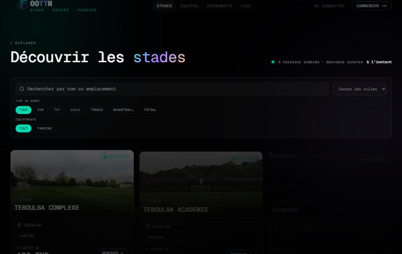

# FootTN — Football stadium booking & community platform

**FootTN** is a full-stack web application for the Tunisian amateur-football scene. Players book stadium slots and pay online, form teams, join matches and post to a community feed. Stadium owners manage their venues and reservations, and administrators moderate the whole platform.

**Live demo:** [foottn.vercel.app](https://foottn.vercel.app/) · **Stack:** Next.js 16 · React 19 · TypeScript · Firebase · Stripe · Tailwind CSS 4



> **Status:** portfolio project with a public demo deployment. Stripe runs in **test mode**. Payment confirmation is still recorded by the client (see [Known limitations](#known-limitations)), so it is not ready to take real money.

## The problem it solves

Booking a five-a-side pitch in Tunisia usually means phone calls, cash payments and WhatsApp groups to gather players. FootTN replaces this with one place to find a free slot, pay, receive a ticket and organise the team, and it gives owners a dashboard of their occupancy and revenue.

## Features

**Players**
- Stadium search with filters, a stadium detail page and a booking widget with hourly slots. Peak hours (from 18:00) cost +20%, and a 4% service fee applies.
- Payment by card (Stripe Payment Element) or from an in-app **wallet** that can be topped up through Stripe.
- PDF receipts (jsPDF), QR-code tickets, a PDF invoice route and booking-confirmation emails (Resend).
- Teams with invitations and real-time team chat (Firestore `onSnapshot`), plus public/private events with automatic team balancing.
- Social feed with posts, likes, comments and notifications. Support tickets with threaded replies.
- Role-aware profile page with player stats and account-health indicators.

**Stadium owners** (`OWNER`)
- Create and edit stadiums with image upload (Cloudinary). New stadiums stay pending until an admin approves them.
- Reservation management and revenue/occupancy analytics charts (Recharts).

**Administrators** (`SUPER_ADMIN`)
- User and role management, stadium approval, event and team oversight, feed moderation, a support-ticket desk and platform analytics.

**Platform**
- Installable PWA manifest, French UI, command menu (⌘K), dark "glass" design system built on Tailwind CSS 4 and shadcn-style primitives.

## Tech stack

| Layer | Technology |
| --- | --- |
| Frontend | Next.js 16 (App Router, Turbopack, React Compiler), React 19, TypeScript, Tailwind CSS 4, Framer Motion, Base UI, Recharts, cmdk |
| Backend | Next.js Route Handlers (Node runtime) on Vercel |
| Auth & data | Firebase Authentication (email/password + Google), Cloud Firestore with security rules |
| Payments | Stripe PaymentIntents + Payment Element (test mode), webhook signature verification |
| Media & email | Cloudinary unsigned uploads, Resend |
| Documents | jsPDF (receipts), pdf-lib (invoices), qrcode |
| Quality | ESLint (eslint-config-next), TypeScript strict mode |

## Architecture

```
 Browser (React 19 client components)
   │  Firebase JS SDK ───────────────► Firebase Auth  ·  Cloud Firestore (security rules)
   │  Stripe.js / Payment Element ───► Stripe
   │  unsigned upload ───────────────► Cloudinary
   │
   │  fetch + "Authorization: Bearer <Firebase ID token>"
   ▼
 Next.js on Vercel
   ├─ src/proxy.ts                 route gating by session/role cookies (UX layer)
   ├─ /api/create-payment-intent   verifies the ID token, re-reads the booking and stadium
   │                               from Firestore as that user, recomputes the price
   │                               server-side, then creates the Stripe PaymentIntent
   ├─ /api/send-booking-email      verifies the ID token; sends only to the caller's own
   │                               address, with data read from the stored booking
   ├─ /api/invoices/[bookingId]    PDF invoice (pdf-lib)
   └─ /api/stripe/webhook          Stripe signature verification
```

**How authentication works.** Firebase Authentication signs users in on the client. The `AuthContext` loads the Firestore profile (`users/{uid}`), including the role (`PLAYER`, `OWNER` or `SUPER_ADMIN`), and sets lightweight cookies that `src/proxy.ts` uses to redirect users away from pages their role cannot open. The real enforcement is in [`firestore.rules`](firestore.rules): users cannot change their own role, owners cannot approve their own stadiums, only booking owners, stadium owners and admins can read a booking, and so on. API routes verify the Firebase ID token against Google's public keys ([`src/lib/server/firebase-auth.ts`](src/lib/server/firebase-auth.ts)) and read Firestore over REST **with the caller's token**, so the same security rules apply on the server.

**How pricing stays consistent.** [`src/lib/pricing.ts`](src/lib/pricing.ts) is shared by the booking widget (display) and the payment route (amount charged). The server never trusts a client-supplied amount for bookings, and it refuses the payment if the stored booking total does not match its own calculation.

## Getting started

### Requirements

- Node.js 20+ and npm
- A Firebase project with Authentication (Email/Password, optionally Google) and Cloud Firestore
- A Stripe account in test mode; optionally Cloudinary and Resend

### Install and run

```bash
git clone https://github.com/Jazy-y/foottn.git
cd foottn
npm ci
cp .env.example .env.local      # PowerShell: Copy-Item .env.example .env.local
npm run dev                     # http://localhost:3000
```

### Environment variables

All variables are documented in [`.env.example`](.env.example):

| Variable | Purpose |
| --- | --- |
| `NEXT_PUBLIC_FIREBASE_*` | Firebase web app config (public by design; access is controlled by security rules) |
| `NEXT_PUBLIC_STRIPE_PUBLISHABLE_KEY`, `STRIPE_SECRET_KEY` | Stripe test keys |
| `STRIPE_WEBHOOK_SECRET` | Optional: webhook signature secret |
| `NEXT_PUBLIC_CLOUDINARY_CLOUD_NAME`, `NEXT_PUBLIC_CLOUDINARY_UPLOAD_PRESET` | Image uploads |
| `RESEND_API_KEY`, `EMAIL_FROM` | Optional: booking-confirmation emails |
| `NEXT_PUBLIC_APP_URL`, `NEXT_PUBLIC_DEMO_MODE` | App URL and demo-build flag |

Deploy the Firestore rules and indexes to your project:

```bash
npx firebase-tools deploy --only firestore:rules,firestore:indexes
```

### Create the first administrator

Roles cannot be granted from the client. Promote an account with the Admin SDK script, using a service-account key stored **outside** the repository:

```powershell
$env:GOOGLE_APPLICATION_CREDENTIALS="C:\secure\service-account.json"
$env:FIREBASE_PROJECT_ID="your-project-id"
npm run create-admin -- admin@example.com "Admin Name"
```

If the account does not exist yet, also set `ADMIN_PASSWORD` (12+ characters). New sign-ups are always `PLAYER`; an admin can make a user an `OWNER` from **Admin → Users**.

### Scripts

| Command | Description |
| --- | --- |
| `npm run dev` | Development server |
| `npm run build` / `npm start` | Production build / serve |
| `npm run lint` | ESLint (0 errors) |
| `npm run typecheck` | TypeScript (`tsc --noEmit`) |
| `npm run create-admin` | Promote a user to `SUPER_ADMIN` (Firebase Admin SDK) |

## Project structure

```text
src/
├── app/
│   ├── (app)/            # Authenticated area: dashboard, bookings, teams, events, feed,
│   │                     # wallet, support, profile, owner/*, admin/*
│   ├── api/              # Route handlers: payments, email, invoices, Stripe webhook
│   ├── stadiums/         # Public stadium list and detail pages
│   └── login, register, forgot-password, offline, manifest.ts
├── components/           # booking/ (BookingWidget), layout/ (navigation, guards), ui/ (design system)
├── contexts/AuthContext  # Firebase session + Firestore profile + role cookies
├── hooks/                # useProfileData (role-specific profile modules)
├── lib/                  # firebase, pricing, api-client, cloudinary, server/firebase-auth
├── services/             # Firestore data access (db.ts), events, feed, team balancing
├── proxy.ts              # Route protection by role
└── types/                # Domain types (User, Stadium, Booking, Team, Event…)
scripts/create-admin.mjs  # Admin SDK role provisioning
firestore.rules           # Role-based access control
```

## Known limitations

- **Payment fulfilment runs on the client.** After Stripe confirms a payment in the browser, the client marks the booking `PAID` and updates the wallet balance. Firestore rules currently allow a user to write those fields on their own booking and profile. Fixing this properly needs the Firebase Admin SDK on the server (a service account in Vercel), so the Stripe webhook can fulfil payments and the rules can stop clients from writing `paymentStatus` and `walletBalance`. The webhook already verifies Stripe signatures and is the place for this.
- Charges are created in **EUR** while prices are shown in TND (Stripe test mode).
- Peak-hour pricing uses the stadium time zone (Africa/Tunis). Bookings made from a browser in another time zone are rejected with a "price has changed" message instead of being charged a different amount.
- The landing page shows illustrative marketing figures, not live statistics.
- No automated test suite yet.

See [SECURITY.md](SECURITY.md) for the security review.
